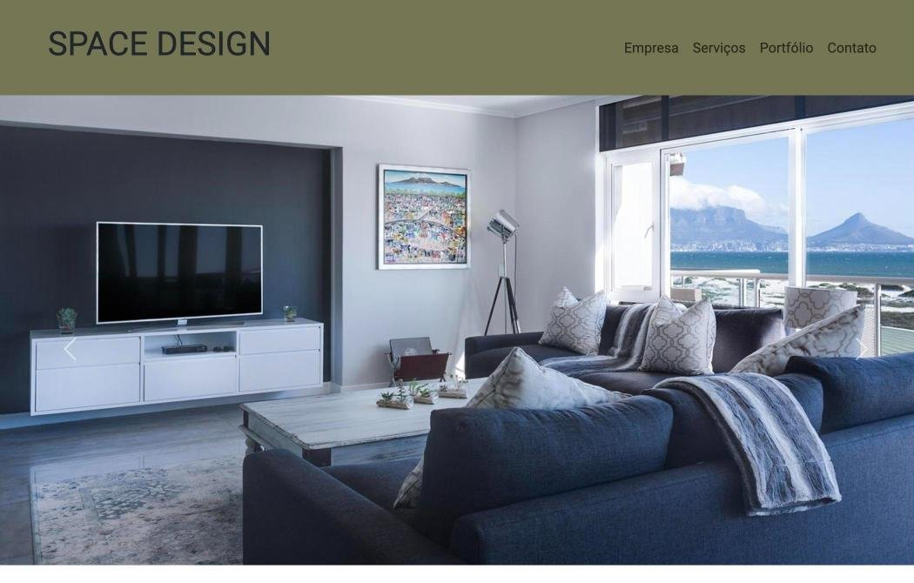
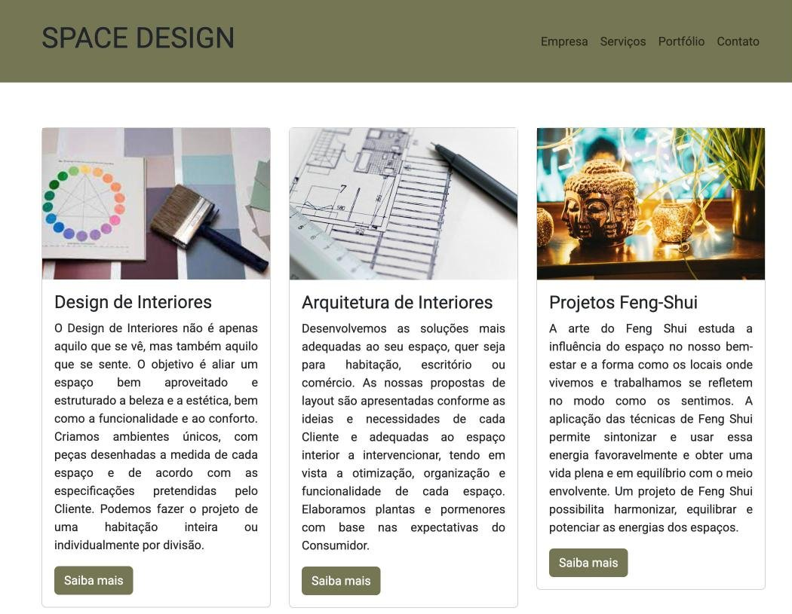

# 🛋️ Space Design

Site institucional de um **estúdio de design e arquitetura de interiores**, com menu fixo, carrossel de imagens e cartões de serviços (Design de Interiores, Arquitetura de Interiores e Projetos Feng-Shui). Construído com **Bootstrap 5**.

🔗 **Demo:** [site-space-design.vercel.app](https://site-space-design.vercel.app)




---

## 📸 Serviços



## ✨ O que pratiquei

- **Bootstrap 5**: `navbar` fixa no topo com menu que colapsa em ecrãs pequenos (`navbar-toggler`)
- **Carrossel** de imagens com indicadores e setas de navegação
- **Cards** com imagem, título, texto e botão, organizados no sistema de grelha (`row` / `col`)
- **Media queries** próprias para ajustar o carrossel em telemóvel e tablet
- Personalização do Bootstrap com CSS próprio (cores e tipografia Roboto)
- Publicação do site na **Vercel**

## 📁 Estrutura

```
├── images/      # Fotografias
├── lib/         # Bootstrap (CSS e JS)
├── index.html   # Página
└── main.css     # Estilos personalizados
```

## ▶️ Como ver

Abre o `index.html` no browser ou visita a [demo](https://site-space-design.vercel.app).

## 📚 Contexto

Projeto desenvolvido no âmbito da formação **Full Stack Java da EBAC** (módulo de Bootstrap), em 2023.

---

Desenvolvido por **Hanna Sampaio** · [LinkedIn](https://www.linkedin.com/in/hannasampaio7/) · [GitHub](https://github.com/hannasampaio)
